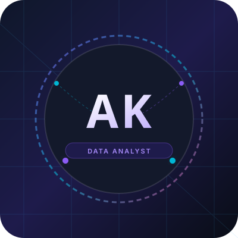

# Adarsh K. — Professional Data Analyst Portfolio Website

A modern, attractive, minimal, and fully responsive personal portfolio website crafted for **Adarsh K.**, an aspiring Data Analyst and current Data Analytics Intern at Softronics, Calicut, Kerala.

Built with a dark technology aesthetic, clean glassmorphic cards, subtle neon glowing accents, smooth micro-interactions, and accessible typography.

---

## 🌟 Live Preview & Architecture Overview

* **Owner:** Adarsh K.
* **Role:** Aspiring Data Analyst | Data Analytics Intern
* **Location:** Calicut, Kerala, India
* **Organization:** Softronics, Calicut
* **Design Philosophy:** Premium dark theme (`#070a12`), purple/violet & cyan data accents, glassmorphic card containers, smooth transitions, and responsive mobile-first grid.

---

## 🛠️ Technologies Used

* **HTML5:** Semantic markup, accessibility labels, Open Graph metadata.
* **CSS3:** Custom CSS variables, glassmorphism (`backdrop-filter`), CSS Grid & Flexbox, smooth animations, and `prefers-reduced-motion` support.
* **Bootstrap 5.3 (CDN):** Responsive grid layout, mobile hamburger navbar, and accessible modal dialogs.
* **Vanilla JavaScript (ES6+):** Scroll tracking, navbar blur on scroll, active section indicator, mobile menu auto-close, dynamic footer year, and contact form validation.
* **Google Fonts:**
  * *Space Grotesk* for modern, tech-forward headings.
  * *Inter* for legible body copy.
  * *JetBrains Mono* for code tags and dates.
* **Font Awesome 6.5.1 (CDN):** Vector iconography for tech tools, contact methods, and UI buttons.

---

## 📁 Project Directory Structure

```text
newportfolio/
├── index.html                   # Core single-page portfolio layout & semantic markup
├── style.css                    # Custom CSS design tokens, components, & responsive queries
├── script.js                    # Interactive DOM behavior, validation, and animations
├── README.md                    # Project documentation & step-by-step customization guide
└── assets/
    ├── avatar-ak.svg            # Modern dark-glass vector avatar placeholder ("AK")
    ├── road-guardian-preview.svg# Visual graphic for Road Guardian Android App
    ├── eda-preview.svg          # Visual graphic for Exploratory Data Analysis project
    └── sql-preview.svg          # Visual graphic for SQL Data Analysis project
```

---

## 🚀 How to Run and Preview the Website Locally

### Method 1: Open Directly in Any Web Browser
Simply double-click `index.html` or right-click and choose **Open with > Google Chrome** (or Edge/Firefox).

### Method 2: Preview in VS Code with Live Server
1. Open this project folder in Visual Studio Code.
2. Install the **Live Server** extension (by Ritwick Dey) from the Extensions tab (`Ctrl+Shift+X`).
3. Right-click `index.html` and select **Open with Live Server**.
4. The site will launch automatically at `http://127.0.0.1:5500`.

### Method 3: Using Python HTTP Server (Terminal)
Open PowerShell or your terminal in this directory and execute:
```powershell
python -m http.server 3000
```
Open your browser and navigate to `http://localhost:3000`.

---

## ✏️ How to Customize Your Portfolio

### 1. Replace the Profile Picture
By default, the website displays `assets/avatar-ak.svg`, an initials graphic featuring **AK**.
* To use your real photo:
  1. Save your photograph inside the `assets/` folder as `profile.jpg` (or `profile.png`).
  2. Open `index.html` and locate line around 125:
     ```html
     
     ```
  3. Change `src="assets/avatar-ak.svg"` to `src="assets/profile.jpg"`.

### 2. Update Social Links & Contact Details
Search for `https://github.com`, `https://linkedin.com`, and `adarshk@example.com` in `index.html`:
* **GitHub Link:** Update `href="https://github.com/your-username"`
* **LinkedIn Link:** Update `href="https://linkedin.com/in/your-profile"`
* **Instagram Link:** Update `href="https://instagram.com/your-handle"`
* **Email Address:** Replace `adarshk@example.com` with your real email in both the `mailto:` links and the visible contact text.

### 3. Update Internship Start Date
In `index.html`, locate the Experience section:
```html
<span>Start Date: [Customizable] — Present</span>
```
Replace `[Customizable]` with your actual month and year (e.g., `Start Date: January 2026 — Present`).

### 4. Attach Your Resume (PDF)
1. Export your resume as `Adarsh_K_Resume.pdf` and copy it into the `assets/` folder.
2. In `index.html`, update the navbar resume button:
   ```html
   <a href="assets/Adarsh_K_Resume.pdf" download class="btn-primary-custom py-2 px-3 text-nowrap">
     <i class="fa-solid fa-file-arrow-down"></i> Resume
   </a>
   ```

### 5. Update Project Repositories & Real Datasets
* **Road Guardian:** Add your GitHub repository link in the project card button (`href="https://github.com/your-username/road-guardian"`).
* **Exploratory Data Analysis (EDA):** Replace the dataset name with the specific dataset analyzed during your Softronics internship (e.g. Sales Trends, Customer Churn, Healthcare, etc.).
* **SQL Data Analysis:** Add your query `.sql` scripts or GitHub repository link.

---

## ✉️ Connecting a Free Contact Form Backend

The contact form includes client-side validation for required fields, email syntax, subject length, and message contents.

To have incoming messages forwarded straight to your personal inbox without configuring a backend server:

### Option A: Using Formspree (Recommended, Free)
1. Go to [formspree.io](https://formspree.io) and create a free account.
2. Click **Create Form** and copy your form endpoint URL (e.g. `https://formspree.io/f/xyzabode`).
3. In `index.html`, update the `<form>` opening tag:
   ```html
   <form id="contactForm" action="https://formspree.io/f/YOUR_FORM_ID" method="POST">
   ```
4. Submissions will now be delivered directly to your email inbox!

### Option B: Using Web3Forms (No Registration Required)
1. Go to [web3forms.com](https://web3forms.com) and enter your email to get a free Access Key.
2. Add a hidden input to `<form>`:
   ```html
   <input type="hidden" name="access_key" value="YOUR_ACCESS_KEY_HERE">
   ```

---

## 🌐 How to Publish Online for Free

### Publishing on GitHub Pages:
1. Create a GitHub repository named `portfolio` (or `username.github.io`).
2. Push your files (`index.html`, `style.css`, `script.js`, `README.md`, and `assets/`) to the repository:
   ```bash
   git init
   git add .
   git commit -m "Initial commit of Adarsh K. portfolio"
   git branch -M main
   git remote add origin https://github.com/your-username/portfolio.git
   git push -u origin main
   ```
3. In your GitHub repository, navigate to **Settings > Pages**.
4. Under **Branch**, select `main` and root `/ (root)`, then click **Save**.
5. Your portfolio will be live at `https://your-username.github.io/portfolio` in 1–2 minutes!

### Publishing on Vercel or Netlify:
* Drag and drop the `newportfolio` folder directly into [netlify.com/drop](https://app.netlify.com/drop) or import from GitHub on [vercel.com](https://vercel.com) for instant SSL-secured hosting.

---

## 📄 License & Attribution
Designed and built for **Adarsh K.** All rights reserved. Free to customize and adapt for professional presentation.
